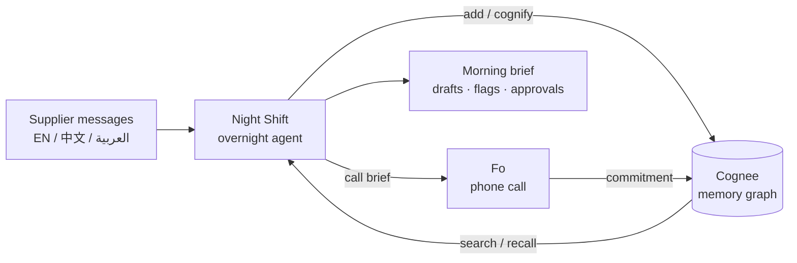

# Night Shift 🌙

**Your suppliers work while you sleep. Now so do you.**

An overnight AI agent that remembers every supplier promise with **Cognee** and calls suppliers in their language with **Fo**.

Built in one night at **Agents After Dark — UC Berkeley (Nov 16, 2026)** · Track: **Best Use of Cognee**

### ▶ [Watch the 2-minute demo](Night_Shift_Final.mp4)

---

## The problem

Small Amazon and Shopify sellers source from factories in China and distributors in Dubai. Those suppliers work while the seller sleeps:

- Delays, price changes, and deposit requests arrive at 2 AM, in **English, Chinese, and Arabic**.
- The seller wakes up a day behind, every day.
- Nobody remembers who promised what. *"Ship by the 20th"* was said on a call three weeks ago, and it's the third delay this year with the same excuse.

## What Night Shift does

1. **Reads every overnight message** and translates it.
2. **Checks Cognee memory before every decision.** Memory holds each supplier's history: past delays, excuses, quotes, disputes, and promises.
3. **Drafts the reply.** The seller just approves it.
4. **Calls the supplier with Fo** when a reply won't do, in the supplier's language, with a call brief built from memory.
5. **Saves the promise back into Cognee.** Commitments from calls become memory, not just transcripts.
6. **Catches broken promises the next night.** If the supplier slips again, Night Shift flags it immediately and cites the exact call where they committed.

By 6 AM the seller has **a brief, not an inbox.**

## Why memory is the product

Without memory this is just a translator. The value is in connecting today's message to everything the supplier said before, across messages, calls, and weeks:

> *"PO-2604 delayed to Apr 28"* → Night Shift knows it's **the 3rd delay this year**, blamed on **the same chip shortage** as PO-2603, and that the seller already asked for realistic dates on Mar 28.

Cognee turns every message and every call into one connected memory graph of suppliers, orders, promises, delays, issues, and calls.



## What's in this repo

| Path | What it is |
|---|---|
| `Night_Shift_Final.mp4` | The 2-minute demo video |
| `salis/` | The overnight engine: Cognee memory, an LLM builder, an independent tester, a repair loop, and a durable job store (see below) |

### `salis/`: the overnight engine (Python)

The engine that runs while you sleep: **Retrieve memory → Construct → Test → Diagnose → Repair → Retest → Morning report.**

| File | Role |
|---|---|
| `salis/memory.py` | Cognee memory: one dataset per workspace (`cognee.remember` / `cognee.recall`), with provenance kept in the ledger |
| `salis/nightshift.py` | The single job pipeline, used by both "Run Now" and the overnight worker |
| `salis/builder.py` | LLM proposes a workflow as typed JSON (construct and repair) |
| `salis/workflow.py` | Schema validation and a deterministic executor |
| `salis/tester.py` | Independent tester that checks the resulting records, not the model's claims |
| `salis/shared.py` | Sanitized, signed lesson shared from another workspace (opt-in, leak and tamper checks) |
| `salis/store.py` | Durable job store: every step persisted, with crash recovery |
| `salis/app.py` | Streamlit dashboard |
| `salis/worker.py` | Background overnight worker |

#### Run it

```bash
cd salis
python -m venv .venv
source .venv/bin/activate          # Windows: .venv\Scripts\activate
pip install -r requirements.txt
cp .env.example .env               # add your OpenAI key (variable names only are committed)
streamlit run app.py               # dashboard: seed memory → Run Now → morning report
python worker.py                   # optional: background overnight worker
python -m pytest tests/            # offline tests, no API key needed
```

## Honest status

- **Working in `salis/`:** Cognee-backed memory, LLM construction, independent testing, the repair loop, the durable job store, and the dashboard, all on synthetic data.
- **Shown in the demo video:** the supplier-facing Night Shift experience (morning brief, Cognee activity log, memory graph, Fo call in Arabic, broken-promise detection). The supplier data in the demo is realistic but synthetic.
- **Fo calling** was connected through the Fo MCP server and tested live during the hackathon.
- **Not built yet:** live ingestion from WhatsApp, WeChat, and email; automatic scheduling in each supplier's time zone; Allowance one-time cards for supplier deposits.

## Built with

[Cognee](https://www.cognee.ai/) (memory) · [Fo by Wajo](https://wajo.ai/) (phone calls) · OpenAI · Python · Streamlit · Claude Code

## Team

Zaid Adassi · *teammate* · *teammate*
